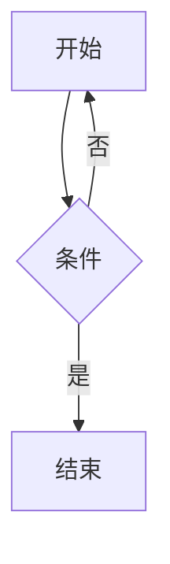

# 金样语料:全元素覆盖

本文是渲染结构契约(docs/渲染结构契约.md)的金样语料。
期望 HTML 由当前 markdown-it 管线冻结生成(corpus.expected.html),任何渲染器(含 TipTap generateHTML)必须逐字节复现它。

## 标题与锚点

# 一级标题

## 二级标题

### 三级标题

#### 四级标题

##### 五级标题

###### 六级标题

Setext 一级标题
===============

中英混排标题 Mixed 中文 Heading
--------------------------------

## 段落与行内元素

普通段落:中英文混排 Themd 是样式自设的本地 Markdown 笔记本,支持 **加粗**、*倾斜*、***粗斜***、~~删除线~~、`行内代码` 和 [链接](https://example.com/docs?a=1&b=2)。

带标题的链接:[带标题链接](https://example.com/titled "链接标题")。

自动链接:https://example.com/auto 会因 linkify 变成超链接;尖括号形式 <https://example.com/angle>。

软换行(breaks):这一行末尾敲了回车
下一行应当出现 br 而不是空格。

硬换行(行尾反斜杠)\
第二行硬换行。

排版替换(typographer):引号 "straight" 与 'single'、省略号 ... 、连字符 -- 长破折 --- 与版权 (c) 2026 Themd。

转义与实体:\*不是斜体\*、\`\`不是代码\`\`、字面实体 &amp; &lt; &gt; &copy;。

## 图片

远程图片带 alt:

带标题图片:

Data URI 截图:

空 alt 图片:

## 列表

### 紧凑列表(无空行)

- 第一项
- 第二项
- 第三项

1. 有序一
2. 有序二
3. 有序三

中间隔一个段落,下一条才是新列表(同类型列表间空行不会断开):

5. start 属性
6. 从第五项开始

### 宽松列表(项间空行)

- 宽松项一

- 宽松项二带第二段

  段落二

### 嵌套列表

- 外层一
  - 内层一
    - 三层
  - 内层二
- 外层二
  1. 有序嵌套
  2. 第二条

### 任务列表

- [ ] 未完成任务
- [x] 已完成任务

## 引用

> 普通引用第一段。
> 同段第二行。

> 引用内嵌 **加粗** 与 `code`。

> > 嵌套引用外层
> > 内层引用。

## GFM 提示块

> [!NOTE]
> 注意事项正文,标记独占首段。

> [!TIP]
> 小技巧。

> [!IMPORTANT]
> 重要信息。

> [!WARNING]
> 警告信息。

> [!CAUTION]
> 危险操作。

> [!TIP] 同段还有正文的情况
> 这一段正文与标记同段。

> [!UNKNOWN]
> 不识别的类型降级为普通引用。

## 代码

行内代码:`npm run dev` 与 `cargo check --manifest-path src-tauri/Cargo.toml`。

```ts
const value: number = 1
export function greet(name: string): string {
  return `Hello, ${name}`
}
```

无语言代码块:

```
plain text
  keep   spacing
```



## 数学

行内公式:质能方程 $E = mc^2$ 出自相对论。

块级公式:

$$
\int_{-\infty}^{\infty} e^{-x^2} \, dx = \sqrt{\pi}
$$

## 表格

| 左对齐 | 居中 | 右对齐 |
| :--- | :---: | ---: |
| a1 | b1 | c1 |
| a2 | b2 | c2 |

## 分隔线

---

## 内嵌 HTML 与实体(html:true)

<div class="custom-block" data-kind="demo">
  <p>块级内嵌 HTML 原样透传。</p>
</div>

<!-- HTML 注释透传 -->

行内内嵌:一段里带 <span style="color: red">红色 span</span>、<u>下划线 u 标签</u> 和实体 &amp; &lt; &gt; &copy;。

脚注语法边界(管线无脚注插件):行内 见[^1] 按 CommonMark 链接引用解析为引用链接,文末定义行被消费为链接定义。

[^1]: 脚注正文会被当作链接目标(已知边界:脚注待管线引入插件后再修订契约)。
